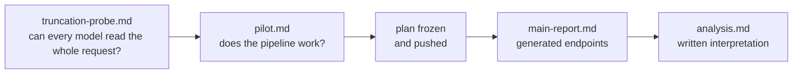

# Results

Every result in this folder is computed from the committed receipts in [`../runs/`](../runs/). Rebuild the database with `./order-blind import` and regenerate the report with `./order-blind report`. The gates ran in this order:

| Document | What it is | Headline |
|---|---|---|
| [`analysis.md`](analysis.md) | **Start here.** Written analysis of the main run, with charts and caveats | Jev is order-blind in both versions (1.13 and 1.14); 1.14 shifts choice primacy by −1.9 pp, still inside the margin. OpenAI Decisions, SubQ Snap and [Rune](https://fireworks.ai/models/fireworks/rune) favor the first response (+6.1, +7.0 and +4.8 pp); Microsoft-Decision-1 disfavors the last (−4.5 pp). Clef-flash is inconclusive. |
| [`main-report.md`](main-report.md) | Generated report: every preregistered and secondary endpoint for all 76,200 requests per model (seven model arms), with 90% bootstrap intervals | Primary endpoints, paired differences from Jev, question-order arm, consistency, ties, planted-bias check, per-subset results, refusals, cost and latency |
| [`pairwise-slots.md`](pairwise-slots.md) | All six pairwise slot contrasts in the choice arm, for every model arm, with the same cluster bootstrap as the main analysis ([script](../scripts/pairwise_slots.py)) | Three shapes: first-slot preference (Decisions, SubQ), monotone decline (Rune, Microsoft-Decision-1), and a zigzag favoring slot 2 (Jev 1.13 +5.5 pp over slot 3; Clef-flash). Jev 1.14 halves the zigzag to +2.7 pp. The pooled-middle endpoints do not show the third shape. |
| [`item-stability.md`](item-stability.md) | Item-level repeat agreement, order agreement, retention, McNemar reorder-vs-repeat tests, and order changes by probability margin, for every arm ([scripts](../scripts/retention.py)) | Mean accuracy moves <0.3 pp across presentations while 18-33% of items change their pick in some ordering; reordering changes picks more than resending for all seven arms (Holm p < 1e-20); above a 0.6 margin Jev changes 1-2% of picks, Decisions and Rune 16-18%. |
| [`official-prompt.md`](official-prompt.md) | The 14,920 choice/haystack requests re-sent to Jev 1.13 and 1.14 with RewardBench 2's anti-position-bias sentence restored ([plan](../plans/official-prompt-v1.md), [receipts](../runs/official-prompt/)) | Slot pattern and order sensitivity unchanged; accuracy -4.2 to -4.3 pp on the same items. |
| [`pilot.md`](pilot.md) | Pilot on 35 seeded items (1,400 requests per model) | Every provider passed, including Jev 1.14 (1,400/1,400, no retries). SubQ: 1,400/1,400, no refusals or invalid answers, $0.1005 estimated list-price cost. Rune: 1,400/1,400, no refusals or invalid answers, $0.0897. |
| [`truncation-probe.md`](truncation-probe.md) | Needle-at-start/end probe of how much request text each model reads | No truncation up to about 9,700 reported tokens for any probed model, SubQ and Jev 1.14 included, so no v1 request was cut short. Rune was not probed; none of its requests (longest 5,568 reported tokens) was rejected. |

Raw receipts: [`../runs/probe/`](../runs/probe/), [`../runs/pilot/`](../runs/pilot/), [`../runs/main/`](../runs/main/). The frozen plan is in [`../frozen/v1/`](../frozen/v1/) and the design in [`../plans/v1-design.md`](../plans/v1-design.md).
